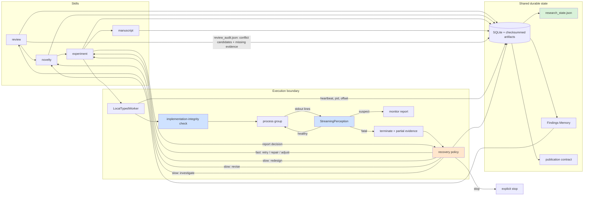

# Before-and-after architecture

Status legend: **[implemented]** completed and tested in this upgrade;
**[future]** documented recommendation, not implemented.

## Before

```mermaid
flowchart LR
    subgraph Skills
      R[review] --> N[novelty] --> E[experiment] --> M[manuscript]
    end
    subgraph Backend
      R --> DB[(SQLite + artifacts)]
      N --> DB
      E --> DB
      M --> DB
      E --> W[LocalTypedWorker]
      W -->|communicate(); exit code only| P[process]
    end
    W -->|worker failure raises| X[workflow stop]
    X -. no reverse edge .-> R
    X -. no reverse edge .-> N
    DB --> F[Findings Memory]
    F -. only analyzed outcomes .-> N
```

The forward path is evidence-gated, but the execution boundary is opaque and
the reverse path is absent. A failed process does not become a finding, and no
stage records what should happen next.

## After



Green/blue/orange nodes are the implemented additions. The reverse edges are
**recommendations with provenance**, not automatic expensive actions: the next
stage is only entered after an explicit resume, and execution still requires a
fresh exact-spec approval.

## Implemented vs future

| Capability | Status | Artifact / entry point |
|---|---|---|
| Probe contract persisted in spec | implemented | `experiment_specs.monitor_contract_json` (schema v17) |
| Streaming perception / early kill | implemented | `experiments/perception.py`, `LocalTypedWorker` |
| Heartbeat + process identity | implemented | `worker_jobs.heartbeat_at/process_id/process_group_id/last_log_offset` |
| Execution monitor evidence | implemented | `execution_monitor` artifact |
| Script-content integrity check | implemented | `implementation_integrity` failure |
| Failure finding in Findings Memory | implemented | `operational_execution_failure` |
| Fast/slow recovery decision | implemented | `recovery_decision` artifact + `research.recovery_decision` event |
| Cross-paper conflict candidates | implemented | `review_audit.json` + review corpus + novelty context + manuscript section |
| Consolidated research state | implemented | `research_state.json`; `autoresearch skill state` |
| Automatic re-entry after refutation | future | requires explicit authorization + loop budget |
| GPU telemetry worker | future | transport-agnostic contract is ready |
| LLM-on-stream consult | future | deterministic checks cover confirmed failures |

## Data-flow invariants (unchanged)

- Every claim still requires a verbatim source excerpt.
- Every execution still requires the exact approval checksum.
- A simulation/fixture artifact still cannot pass the manuscript evidence gate.
- The manuscript still cannot run without an analyzed experiment report.
- No new database/framework was introduced; schema v17 adds two additive columns.
